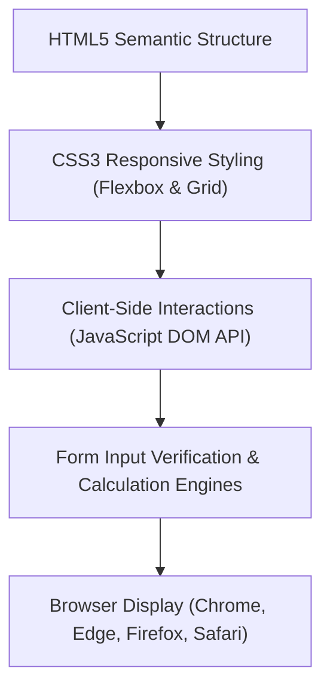

# 🌐 Full-Stack Web Development Practical Labs

<p align="center">
  
</p>

<p align="center">
  A hands-on collection of 39 frontend and full-stack web development laboratory components, responsive UI pages, dynamic DOM manipulation scripts, and ES6+ JavaScript exercises completed at Alliance University.
</p>

<p align="center">
  <a href="https://github.com/prakruthidevanga/FSD_Prakruthi_BR">
    
  </a>
</p>

<p align="center">
  
  
  
  
</p>

---

## 📌 Table of Contents

- [📖 Project Overview](#-project-overview)
- [🎯 Objectives](#-objectives)
- [✨ Key Laboratory Components](#-key-laboratory-components)
- [🏗️ Component Architecture](#️-component-architecture)
- [🛠️ Technology Stack](#️-technology-stack)
- [📁 Repository Structure](#-repository-structure)
- [⚙️ How to View & Explore](#️-how-to-view--explore)
- [🔮 Future Enhancements](#-future-enhancements)
- [🤝 Contributing](#-contributing)
- [👩‍💻 Author & Accreditations](#-author--accreditations)

---

## 📖 Project Overview

Front-end web development requires a solid foundation in document object model (DOM) tree structures, CSS layout algorithms (Flexbox, Grid), and modern asynchronous JavaScript syntax.

This repository captures **39 laboratory components** authored throughout the undergraduate Full-Stack Development curriculum at Alliance University. Spanning accessible registration forms with client-side verification, interactive JavaScript calculators, responsive timetable grids, and arrow function demonstrations, the repository reflects hands-on frontend web mastery.

🌐 **Core Mission:** Master foundational web standards and DOM manipulation using clean, modern web technologies.

---

## 🎯 Objectives

- 📐 **Semantic Markup:** Construct accessible forms, tables, and document structures adhering to W3C standards.
- 🎨 **Responsive Styling:** Build Flexbox and CSS Grid layouts that adapt smoothly across desktop and mobile screens.
- ⚡ **Dynamic DOM Manipulation:** Handle browser events, keyboard listeners, and form validations dynamically in JavaScript.
- 🧩 **ES6+ Modern Syntax:** Implement modern JavaScript idioms including arrow functions, template literals, and array methods (`map`, `filter`).

---

## ✨ Key Laboratory Components

| Practical File | Category | Key Implementation Concepts |
| :--- | :--- | :--- |
| `Alliance_Login_Form.html` | Forms & Validation | Responsive login UI, input constraints, and client verification |
| `Registration_Form.html` | User Onboarding | Multi-field validation, password confirmation, and radio selectors |
| `Calculators.html` | Interactive Apps | Dynamic calculation engine using JavaScript event listeners |
| `College_Time_Table.html` | Tabular Layouts | Complex HTML table structuring with rowspans and colspans |
| `Resturant_Menu.html` | UI Catalogs | Card-based catalog layout with pricing badges and images |
| `Arrow_Functions.html` | Modern JS | ES6 arrow functions, lexical `this`, and concise return syntax |
| `Basics and Variables in js.html` | JS Fundamentals | Variable scoping (`var`, `let`, `const`) and type coercion |

---

## 🏗️ Component Architecture



---

## 🛠️ Technology Stack

<p align="center">
  
</p>

| Component | Technology | Implementation Details |
| :--- | :--- | :--- |
| **Markup Language** | HTML5 | Semantic elements, accessible form tags, table grids |
| **Styling** | CSS3 | Flexbox, Grid layouts, custom CSS properties, transitions |
| **Scripting** | JavaScript (ES6+) | Event listeners, DOM manipulation, function closures |

---

## 📁 Repository Structure

```text
FSD_Prakruthi_BR/
├── Alliance_Login_Form.html
├── Registration_Form.html
├── Calculators.html
├── College_Time_Table.html
├── Resturant_Menu.html
├── Arrow_Functions.html
├── Basics and Variables in js.html
├── [32 additional lab files...]
└── README.md
```

---

## ⚙️ How to View & Explore

1. Clone this repository:
   ```bash
   git clone https://github.com/prakruthidevanga/FSD_Prakruthi_BR.git
   cd FSD_Prakruthi_BR
   ```
2. Open any `.html` file directly in any modern browser:
   ```bash
   # On Windows (PowerShell)
   Start-Process "Calculators.html"
   ```

---

## 🔮 Future Enhancements

- ⚛️ **Component Refactoring:** Port key HTML widgets into reusable React functional components.
- 🎨 **Tailwind CSS Integration:** Redesign forms using utility-first modern CSS classes.

---

## 🤝 Contributing

Contributions and lab variations are welcomed!

---

## 👩‍💻 Author & Accreditations

**Prakruthi B R**  
*BCA Student specializing in Artificial Intelligence & Machine Learning*  
*Alliance University, Bengaluru (CGPA: 9.60)*  
*GeeksforGeeks Campus Mantri (2026)*

- 💻 **GitHub:** [@prakruthidevanga](https://github.com/prakruthidevanga)
- 🔗 **LinkedIn:** [Prakruthi BR](https://linkedin.com/in/prakruthi-br)
- 🌐 **Portfolio:** [prakruthidevanga.github.io](https://prakruthidevanga.github.io/)
- 📬 **Email:** [prakruthibr2006@gmail.com](mailto:prakruthibr2006@gmail.com)

---

<p align="center">
  <b>🌐 Mastering the interactive building blocks of modern web applications.</b>
</p>

<p align="center">
  
</p>
